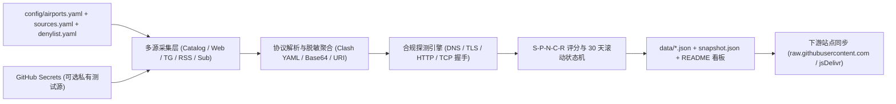

# LBird机场测评 (LBird-Airport-Review)

> [!CAUTION]
> **纯技术学习研究声明 · 不构成任何建议**  
> 本仓库的所有代码、采集脚本、统计指标与自动化输出数据**仅用于网络探测、协议解析、异步爬虫工程与自动化可观测性技术学习**，**不构成任何购买、使用、推荐或投资建议**。  
> 本仓库**不提供、不托管、不销售、不分发任何 VPN 或代理节点服务**；公开输出文件**绝不包含**任何服务器地址、端口、密码、UUID 或私有订阅链接。  
> 完整条款及 48 小时侵权/下架处理通道请阅读 [DISCLAIMER.md](./DISCLAIMER.md)。

---

## 实时自动化探测看板 (Live Snapshot)

<!-- AUTO_DASHBOARD_START -->
> 最近一次自动探测时间：`2026-11-24 01:03 UTC+8`（共 `5` 个样本，纯技术学习用途，不构成任何建议）

| 目标 | 状态 | 综合分 | 节点数 | 延迟 (ms) | 可用率 | 探测模式 |
| :--- | :---: | :---: | :---: | :---: | :---: | :---: |
| [V2RayAggregator 开源样本](https://github.com/mahdibland/V2RayAggregator) | 🟢 normal | **94.70** | 4095 | 3.39 | 100.0% | `tcp_passive` |
| [Barry-V2ray 开源样本](https://github.com/barry-far/V2ray-Config) | 🟢 normal | **94.30** | 207 | 3.14 | 100.0% | `tcp_passive` |
| [Pawdroid 开源样本](https://github.com/Pawdroid/Free-servers) | 🟢 normal | **93.30** | 11 | 1.67 | 100.0% | `tcp_passive` |
| [Au1rxx 开源聚合样本](https://github.com/Au1rxx/free-vpn-subscriptions) | 🟢 normal | **92.75** | 560 | 30.55 | 100.0% | `tcp_passive` |
| [NoMoreWalls 开源样本](https://github.com/peasoft/NoMoreWalls) | 🟢 normal | **88.05** | 117 | 15.46 | 87.5% | `tcp_passive` |
<!-- AUTO_DASHBOARD_END -->

---

## 架构设计



### 核心特性

1. **合规与安全边界**：内置 `robots.txt` 尊重、单域名速率限制、SSRF 防护（拒绝内网/回环/元数据 IP），绝不绕过验证码、人机校验或登录鉴权；公开输出在导出前执行正则防泄密校验。
2. **多格式节点解析与脱敏**：原生支持 Clash/Mihomo YAML、Base64 订阅与纯文本多协议 URI（`ss/vmess/vless/trojan/hysteria2/tuic`），按 `(protocol, host, port)` 去重，并在内存中完成地区、线路与并发 TCP 握手探测后立即销毁节点明文。
3. **S-P-N-C-R 五维客观评分**：
   - `S` (Stability 30%)：网站存活 + 抽样节点 TCP 握手可用率
   - `P` (Performance 25%)：吞吐速率（可选 CLI 测速）或被动响应效率（被动模式下严格封顶 88 分）
   - `N` (Network 20%)：中位 RTT 延迟、失败率与覆盖地区广度
   - `C` (Cost 15%)：月付成本、试用与退款支持度
   - `R` (Risk 10%)：DNS/TLS 证书健康度、连续异常次数、频道活跃度与外部风险源交叉比对

---

## 快速扩展与接入指南

### 1. 添加自定义监测目标

直接在 GitHub 网页端编辑 [`config/airports.yaml`](./config/airports.yaml)，参照文件底部的注释模板添加条目并提交至 `main` 分支，GitHub Actions 会自动触发新一轮采集。

### 2. 安全注入私有测试订阅（绝不入库）

在仓库 `Settings -> Secrets and variables -> Actions` 中新增 Secret `LBIRD_SUBSCRIPTIONS_JSON`，内容为 JSON 映射：

```json
{
  "my-target-slug": "https://example.com/sub?token=your-private-token"
}
```

工作流运行时仅在内存中读取该环境变量，绝不会将其写入 `data/*.json` 或日志。

### 3. 下游站点拉取标准 JSON

- **Raw 直连**：`https://raw.githubusercontent.com/Will9529/LBird-Airport-Review/main/data/snapshot.json`
- **jsDelivr CDN**：`https://cdn.jsdelivr.net/gh/Will9529/LBird-Airport-Review@main/data/snapshot.json`

也支持按表独立拉取 `data/airports.json`、`data/deals.json`、`data/news.json`、`data/risk.json`、`data/reports.json`、`data/stats.json`。

---

## 本地运行与测试

```bash
pip install -r requirements.txt
PYTHONPATH=src python -m lbird.cli run --config-dir config --data-dir data --readme README.md
PYTHONPATH=src python -m lbird.cli validate --data-dir data
pytest -v
```
