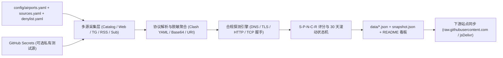

# LBird机场测评 (LBird-Airport-Review)

> [!CAUTION]
> **纯技术学习研究声明 · 不构成任何建议**  
> 本仓库的所有代码、采集脚本、统计指标与自动化输出数据**仅用于网络探测、协议解析、异步爬虫工程与自动化可观测性技术学习**，**不构成任何购买、使用、推荐或投资建议**。  
> 本仓库**不提供、不托管、不销售、不分发任何 VPN 或代理节点服务**；公开输出文件**绝不包含**任何服务器地址、端口、密码、UUID 或私有订阅链接。  
> 完整条款及 48 小时侵权/下架处理通道请阅读 [DISCLAIMER.md](./DISCLAIMER.md)。

---

## 在线交互式看板与专题入口 (Web Dashboard)

- **在线实时榜单**：[https://lbrid.win/](https://lbrid.win/) — S-P-N-C-R 五维评分、实时测速曲线与稳定机场推荐
- **全量机场排行**：[https://lbrid.win/rankings](https://lbrid.win/rankings) — 按专线、地区、月付价格与客户端多维筛选
- **客户端官方下载**：[https://lbrid.win/clash](https://lbrid.win/clash) — Clash Verge Rev / Mihomo Party / FlClash / v2rayN / Shadowrocket
- **高性价比便宜机场**：[https://lbrid.win/topics/cheap](https://lbrid.win/topics/cheap) · **IEPL/IPLC 专线**：[https://lbrid.win/topics/iepl](https://lbrid.win/topics/iepl) · **ChatGPT / AI 解锁**：[https://lbrid.win/topics/chatgpt](https://lbrid.win/topics/chatgpt)
- **跑路风险监测**：[https://lbrid.win/risk](https://lbrid.win/risk)

---

## 实时自动化探测看板 (Live Snapshot)

<!-- AUTO_DASHBOARD_START -->
> 最近一次自动探测时间：`2026-11-26 06:01 UTC+8`（共收录 `136` 个观测目标：🟢 正常 `80` · 🟡 观察 `0` · 🔴 风险 `56`；纯技术学习用途，不构成任何建议）

### 观测榜单节选（Top 30，完整全量见 [`data/airports.json`](./data/airports.json)）

| 目标 | 状态 | 综合分 | 节点数 | 延迟 (ms) | 可用率 | 采集模式 |
| :--- | :---: | :---: | :---: | :---: | :---: | :---: |
| 速界 | 🟢 normal | **92.70** | 52 | 37.0 | 100.0% | `directory_bench` |
| edgenova | 🟢 normal | **92.50** | 42 | 39.0 | 100.0% | `directory_bench` |
| 光速云 | 🟢 normal | **92.40** | 50 | 36.5 | 100.0% | `directory_bench` |
| 极连云 | 🟢 normal | **92.05** | 58 | 40.5 | 100.0% | `directory_bench` |
| [光年梯](https://vv3dbvb.guangnianertt1.homes/) | 🟢 normal | **90.75** | 62 | 19.37 | 99.0% | `web_health` |
| 全球云 | 🟢 normal | **90.55** | 63 | 41.0 | 96.97% | `directory_bench` |
| [Pawdroid 开源样本](https://github.com/Pawdroid/Free-servers) | 🟢 normal | **88.10** | 8 | 140.92 | 100.0% | `tcp_passive` |
| [快狸](https://everett7623.kuailiaff.com/) | 🟢 normal | **87.50** | 38 | 137.21 | 99.0% | `web_health` |
| [二猫云](https://vpsknow.ermaoaff.com/) | 🟢 normal | **87.50** | 40 | 136.0 | 99.0% | `web_health` |
| [宇宙云](https://01.yuzoucloud.cc/) | 🟢 normal | **86.75** | 60 | 136.16 | 99.0% | `web_health` |
| [榴莲云](https://everettvip01.liulianyunaff.com/) | 🟢 normal | **86.70** | 0 | 159.7 | 99.0% | `web_health` |
| [AmyTelecom](https://www.amytele.co/) | 🟢 normal | **86.40** | 0 | 48.7 | 96.0% | `web_health` |
| [边缘节点](https://evervip01.edgenovaaff.com/) | 🟢 normal | **86.30** | 0 | 138.5 | 99.0% | `web_health` |
| [U1S1](https://everett7623.vipaff.cc/) | 🟢 normal | **85.70** | 58 | 136.89 | 99.0% | `web_health` |
| [灵猫网络](https://lm.civetxx.cfd/) | 🟢 normal | **85.45** | 50 | 182.78 | 99.0% | `web_health` |
| [顺畅网络](https://scwljsq.scl168.club/) | 🟢 normal | **84.70** | 0 | 183.14 | 99.0% | `web_health` |
| [飞猫云](https://iopbn.civetnetfttt1.homes/) | 🟢 normal | **84.65** | 88 | 204.2 | 99.0% | `web_health` |
| [可信云](https://everett7623.kosingaff.com/) | 🟢 normal | **84.65** | 50 | 200.67 | 99.0% | `web_health` |
| [YToo](https://y-too.com/) | 🟢 normal | **84.50** | 0 | 141.66 | 96.0% | `web_health` |
| [环球梯](https://everett7623.huanqiutiaff.com/) | 🟢 normal | **84.25** | 60 | 157.4 | 99.0% | `web_health` |
| [神行加速](https://everett01.shenxingaff.com/) | 🟢 normal | **84.00** | 0 | 160.06 | 99.0% | `web_health` |
| [无忧链接](https://wf.worryfreettt.xyz/) | 🟢 normal | **83.95** | 0 | 179.18 | 99.0% | `web_health` |
| [唯兔云](https://vfdgd5.fedttt.my/) | 🟢 normal | **83.80** | 50 | 179.72 | 99.0% | `web_health` |
| [NoMoreWalls 开源样本](https://github.com/peasoft/NoMoreWalls) | 🟢 normal | **83.60** | 111 | 137.66 | 87.5% | `tcp_passive` |
| [瞬云](http://ddd.jichang.best/) | 🟢 normal | **83.45** | 0 | 192.93 | 99.0% | `web_health` |
| [九云](https://216.236.63.122/) | 🟢 normal | **83.05** | 0 | 219.55 | 99.0% | `web_health` |
| [FlowerCloud](https://api-flowercloud.com/) | 🟢 normal | **82.55** | 0 | 79.15 | 96.0% | `web_health` |
| [一翻云](https://vpsknow.yifanaff.com/) | 🟢 normal | **81.95** | 85 | 198.75 | 99.0% | `web_health` |
| 动力港 | 🟢 normal | **81.80** | 70 | 85.0 | 92.0% | `directory_index` |
| [Nexitally](https://nxonearth.com/) | 🟢 normal | **81.60** | 0 | 39.62 | 96.0% | `web_health` |

### 风险与跑路预警节选（共 `56` 条，完整见 [`data/risk.json`](./data/risk.json)）

| 目标 | 状态 | 综合分 | 说明 |
| :--- | :---: | :---: | :--- |
| Kuromis | 🔴 risk | **63.80** | 自动化探测连续 3 次异常（可用率 70.0%），已触发风险观察。 |
| Barry-V2ray 开源样本 | 🔴 risk | **59.85** | 自动化探测连续 0 次异常（可用率 37.5%），已触发风险观察。 |
| V2RayAggregator 开源样本 | 🔴 risk | **54.80** | 自动化探测连续 0 次异常（可用率 18.8%），已触发风险观察。 |
| ANDY CLOUD | 🔴 risk | **38.55** | 自动化探测连续 1 次异常（可用率 15.0%），已触发风险观察。 |
| 自由猫 | 🔴 risk | **38.55** | 自动化探测连续 1 次异常（可用率 15.0%），已触发风险观察。 |
| 仙路湾 | 🔴 risk | **38.55** | 自动化探测连续 1 次异常（可用率 15.0%），已触发风险观察。 |
| 夜煞云 | 🔴 risk | **38.55** | 自动化探测连续 1 次异常（可用率 15.0%），已触发风险观察。 |
| KuLi云 | 🔴 risk | **38.55** | 自动化探测连续 1 次异常（可用率 15.0%），已触发风险观察。 |
| SakuraCat | 🔴 risk | **38.55** | 自动化探测连续 1 次异常（可用率 15.0%），已触发风险观察。 |
| 瑶瑶领先 | 🔴 risk | **38.55** | 自动化探测连续 1 次异常（可用率 15.0%），已触发风险观察。 |
| Now加速 | 🔴 risk | **38.55** | 自动化探测连续 1 次异常（可用率 15.0%），已触发风险观察。 |
| prprCloud | 🔴 risk | **38.55** | 自动化探测连续 1 次异常（可用率 15.0%），已触发风险观察。 |
| 扬帆云 | 🔴 risk | **38.55** | 自动化探测连续 1 次异常（可用率 15.0%），已触发风险观察。 |
| SS-ID | 🔴 risk | **38.55** | 自动化探测连续 1 次异常（可用率 15.0%），已触发风险观察。 |
| 酷酷云 | 🔴 risk | **38.55** | 自动化探测连续 1 次异常（可用率 15.0%），已触发风险观察。 |
<!-- AUTO_DASHBOARD_END -->

---

## 架构设计



### 核心特性

1. **合规与安全边界**：内置 `robots.txt` 尊重、单域名速率限制、SSRF 防护（拒绝内网/回环/元数据 IP），绝不绕过验证码、人机校验或登录鉴权；公开输出在导出前执行正则防泄密校验。
2. **多格式节点解析与脱敏**：原生支持 Clash/Mihomo YAML、Base64 订阅与纯文本多协议 URI（`ss/vmess/vless/trojan/hysteria2/tuic`），按 `(protocol, host, port)` 去重，并在内存中完成地区、线路与并发 TCP 握手探测后立即销毁节点明文。
3. **S-P-N-C-R 五维客观评分**：
   - `S` (Stability 30%)：网站存活 + 抽样节点 TCP 握手可用率
   - `P` (Performance 25%)：吞吐速率（可选 CLI 测速）或被动响应效率（被动模式下严格封顶 88 分）
   - `N` (Network 20%)：中位 RTT 延迟、失败率与覆盖地区广度
   - `C` (Cost 15%)：月付成本、试用与退款支持度
   - `R` (Risk 10%)：DNS/TLS 证书健康度、连续异常次数、频道活跃度与外部风险源交叉比对

---

## 快速扩展与接入指南

### 1. 添加自定义监测目标

直接在 GitHub 网页端编辑 [`config/airports.yaml`](./config/airports.yaml)，参照文件底部的注释模板添加条目并提交至 `main` 分支，GitHub Actions 会自动触发新一轮采集。

### 2. 安全注入私有测试订阅（绝不入库）

在仓库 `Settings -> Secrets and variables -> Actions` 中新增 Secret `LBIRD_SUBSCRIPTIONS_JSON`，内容为 JSON 映射：

```json
{
  "my-target-slug": "https://example.com/sub?token=your-private-token"
}
```

工作流运行时仅在内存中读取该环境变量，绝不会将其写入 `data/*.json` 或日志。

### 3. 下游站点拉取标准 JSON

- **Raw 直连**：`https://raw.githubusercontent.com/Will9529/LBird-Airport-Review/main/data/snapshot.json`
- **jsDelivr CDN**：`https://cdn.jsdelivr.net/gh/Will9529/LBird-Airport-Review@main/data/snapshot.json`

也支持按表独立拉取 `data/airports.json`、`data/deals.json`、`data/news.json`、`data/risk.json`、`data/reports.json`、`data/stats.json`。

---

## 本地运行与测试

```bash
pip install -r requirements.txt
PYTHONPATH=src python -m lbird.cli run --config-dir config --data-dir data --readme README.md
PYTHONPATH=src python -m lbird.cli validate --data-dir data
pytest -v
```
